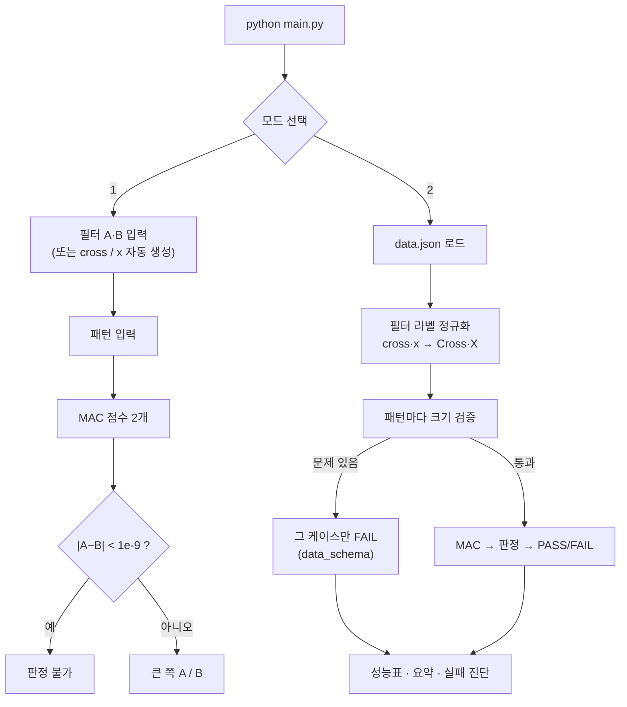
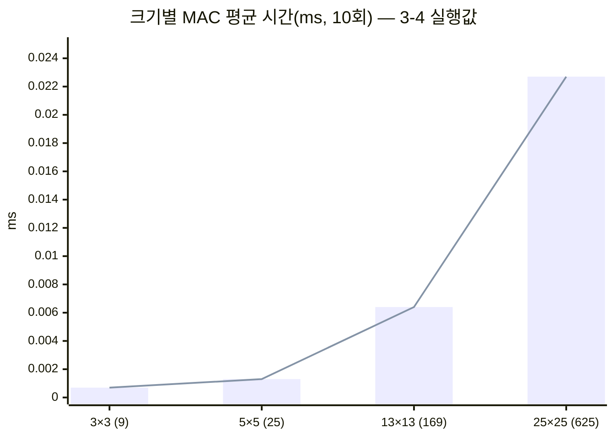

<div align="center">

# 🧮 Mini NPU Simulator

### AI 가 계산하는 방식을 흉내 내는 작은 계산기 — 곱해서 더하면 모양을 알아본다


-FF385C)
-222222)


AI올인원 입학연수 · 개발 입문

| 십자가 `Cross` | 대각선 `X` | 점수 = Σ 패턴 × 필터 |
|:---:|:---:|:---:|
| ⬜🟥⬜<br>🟥🟥🟥<br>⬜🟥⬜ | 🟥⬜🟥<br>⬜🟥⬜<br>🟥⬜🟥 | X 패턴 × X 필터 = **5**<br>X 패턴 × Cross 필터 = **1**<br>→ 판정 **X** |

</div>

---

## 🧒 쉽게 말하면

> 투명 필름에 **십자가(+)** 를 그린 것 한 장, **X** 를 그린 것 한 장이 있다.
> 알아맞힐 그림 위에 필름을 한 장씩 겹쳐 보고, **색칠된 칸이 더 많이 겹치는 필름**의 이름을 답으로 고른다.
> 이 프로그램은 그 「겹쳐 보고 세기」를 숫자로 한다 — 칸마다 **곱하고**, 그걸 전부 **더한다**. 이게 **MAC 연산**이다.

AI 가 사진 속 고양이를 알아보는 것도 크게 보면 같은 일을 엄청나게 많이, 빨리 하는 것이다.
그 일만 전문으로 하는 칩이 **NPU** 이고, 이 프로그램은 그걸 파이썬 몇 줄로 흉내 낸 **작은 NPU(Mini NPU)** 다.

| 그림(패턴) | 필름(필터) | 겹친 칸 | 점수 |
|:---:|:---:|:---:|:---:|
| 🟥⬜🟥<br>⬜🟥⬜<br>🟥⬜🟥 | X 필름<br>🟥⬜🟥<br>⬜🟥⬜<br>🟥⬜🟥 | 5칸 전부 겹침 | **5** |
| 🟥⬜🟥<br>⬜🟥⬜<br>🟥⬜🟥 | 십자가 필름<br>⬜🟥⬜<br>🟥🟥🟥<br>⬜🟥⬜ | 가운데 1칸만 겹침 | **1** |

→ X 필름 점수(5)가 더 크니까 답은 **X**.

> [!TIP]
> **처음이면 [준비물](#-준비물) → [따라 하기](#-따라-하기) 두 절만 보면 된다.** 그 아래 1~7절은 과제 채점용 기록(구현 설명·결과 분석)이다.

> [!IMPORTANT]
> 과제 `data.json` 6개 중 **3개는 FAIL** 이 나오는 게 정상이다. 버그가 아니다 — 두 필름 점수가 수학적으로 똑같이 나오도록(0.9 = 0.9)
> 만든 문제라, 「둘이 같으면 판정하지 않는다」는 규칙에 따라 「판정 불가」가 됐다. 이유는 [4-1](#4-1-실패-원인-분석--6개-중-3개-fail-전부-수치-비교-원인).

## 📚 목차
- 처음 하는 사람: [쉽게 말하면](#-쉽게-말하면) · [준비물](#-준비물) · [따라 하기](#-따라-하기) · [용어 사전](#-용어-사전)
- 과제 기록: [1. 실행 방법](#️-1-실행-방법) · [2. 구현 요약](#-2-구현-요약) · [3. 실행 결과](#️-3-실행-결과) · [4. 결과 리포트](#-4-결과-리포트) · [5. 설명](#-5-설명) · [6. 파일 구성](#-6-파일-구성) · [7. 과정 연결](#-7-과정-연결)

## 🧰 준비물
아무것도 몰라도 된다. 아래 세 가지만 있으면 된다.

| 필요한 것 | 어떻게 확인하나 | 없으면 |
|---|---|---|
| 💻 컴퓨터 1대 | Windows · macOS · Linux 아무거나 | — |
| ⌨️ 터미널(글자로 명령을 치는 창) | Windows: 시작 메뉴에서 `PowerShell` 검색 · macOS: `⌘ + Space` → `터미널` · Linux: `Ctrl + Alt + T` | 모든 컴퓨터에 이미 들어 있다 |
| 🐍 Python 3.8 이상 | 터미널에 `python3 --version`(Windows 는 `python --version`) → `Python 3.12.4` 처럼 3.8 이상 숫자가 나오면 OK | [python.org](https://www.python.org/downloads/) 에서 받아 설치. Windows 는 설치 첫 화면의 **「Add python.exe to PATH」를 꼭 체크** |

- 추가로 설치할 것(라이브러리)은 **없다**. 파이썬에 처음부터 들어 있는 기능만 쓴다.
- 이 저장소에서 필요한 파일은 `main.py`(프로그램)와 `data.json`(문제 데이터) **두 개**뿐이다.
- 이 문서의 명령은 macOS·Linux 기준으로 `python3` 라고 썼다. **Windows 에서는 `python3` 대신 `python` 이라고 친다.**

## 🚶 따라 하기
천천히 해도 10분이면 끝난다. 각 단계마다 **칠 것 → 나와야 하는 화면 → 무슨 뜻인지** 순서로 적었다.

1. **파일을 받는다.**
   [GitHub 저장소 페이지](https://github.com/dicia-jhoh/codyssey-aio-e1-3)에서 초록색 **[Code]** 버튼 → **[Download ZIP]** 을 누르고, 받은 ZIP 파일의 압축을 푼다.
   Git 을 쓸 줄 알면 `git clone https://github.com/dicia-jhoh/codyssey-aio-e1-3.git` 도 된다.
   🆘 ZIP 이 안 되면 `main.py` 와 `data.json` 두 파일만 **같은 폴더**에 받아 둬도 된다.

2. **터미널에서 그 폴더로 들어간다.** `cd ` 까지 치고(뒤에 빈칸 하나), 압축을 푼 폴더를 터미널 창으로 **끌어다 놓으면** 경로가 자동으로 써진다. 그다음 Enter.
   들어왔는지 확인하려고 파일 목록을 본다.
   ```bash
   # 파일 목록 보기 (Windows PowerShell 에서도 ls 가 된다)
   ls
   ```
   👀 아래 두 이름이 보이면 성공이다(README.md 등 다른 파일이 같이 보여도 괜찮다).
   ```text
   data.json   main.py
   ```
   🆘 `main.py` 가 안 보이면 다른 폴더에 있는 것이다. 1단계에서 압축 푼 폴더를 다시 끌어다 놓는다.

3. **프로그램을 켜고 `2` 를 눌러 과제 데이터를 채점한다.**
   ```bash
   # 프로그램 실행 (Windows 는 python main.py)
   python3 main.py
   ```
   `선택:` 이 나오면 `2` 를 치고 Enter. 화면이 쭉 지나간다. 아래쪽에서 이 부분을 찾는다.
   ```text
   # [4] 결과 요약
   #---------------------------------------
   총 테스트: 6개
   통과: 3개
   실패: 3개
   ```
   💬 무슨 뜻? 문제 6개를 풀어서 3개는 맞히고 3개는 「판정 불가」로 FAIL 이 났다. **이게 정답이다**(위 IMPORTANT 상자 참고).
   🆘 `python3: command not found`(또는 `'python3'은(는) … 아닙니다`)가 나오면 Python 이 없거나 이름이 다른 것이다 → `python main.py` 로 다시 쳐 보고, 그래도 안 되면 준비물 표대로 설치한다.

4. **직접 문제를 낸다 — X 그림 맞히기.** 다시 `python3 main.py` 를 치고, 이번엔 아래를 **한 줄씩** 치고 Enter.

   | 화면에 나오는 말 | 칠 것 | 뜻 |
   |---|---|---|
   | `선택:` | `1` | 내가 직접 입력하는 모드 |
   | `필터 A (3줄 입력 …)` | `cross` | 필름 A = 십자가 모양(한 단어로 치면 3×3 을 자동으로 만들어 준다) |
   | `필터 B (3줄 입력 …)` | `x` | 필름 B = X 모양 |
   | `패턴 (3줄 입력 …)` | `x` | 맞힐 그림 = X 모양 |

   👀 이렇게 나오면 성공이다(시간 숫자는 컴퓨터마다 조금 다르다).
   ```text
   A 점수: 1.0
   B 점수: 5.0
   연산 시간(평균/10회): 0.0013 ms
   판정: B
   ```
   💬 무슨 뜻? X 그림에 십자가 필름(A)을 겹치면 1칸, X 필름(B)을 겹치면 5칸이 겹친다. 더 많이 겹친 **B(X)** 가 답이다 — 맨 위 「쉽게 말하면」 표와 똑같다.

5. **컴퓨터가 헷갈리는 경우를 본다 — 「판정 불가」.** 다시 `python3 main.py` → `1` 을 치고, 이번엔 한 줄에 숫자 3개씩 띄어 쓰며 9줄을 친다.

   | 차례 | 칠 것(3줄씩) |
   |---|---|
   | 필터 A | `0.1 0.2 0` → `0 0 0` → `0 0 0` |
   | 필터 B | `0.3 0 0` → `0 0 0` → `0 0 0` |
   | 패턴 | `1 1 1` → `1 1 1` → `1 1 1` |

   👀 이렇게 나오면 성공이다.
   ```text
   A 점수: 0.30000000000000004
   B 점수: 0.3
   판정: 판정 불가 (|A-B| < 1e-9)
   ```
   💬 무슨 뜻? 사람 눈에는 0.1 + 0.2 = 0.3 이니 A 와 B 가 같다. 그런데 컴퓨터는 0.1 을 정확히 못 적어서 **아주 조금 큰 수(0.30000000000000004)** 를 만든다.
   그냥 크기만 비교하면 A 가 「이긴」 것처럼 보이니까, 이 프로그램은 **차이가 0.000000001 보다 작으면 같은 점수로 보고** 판정하지 않는다. 3단계의 FAIL 3개도 같은 이유다.

6. **일부러 틀려 본다.** `python3 main.py` → `1` → 필터 A 첫 줄에 숫자를 2개만(`0 1`) 친다.
   👀 프로그램이 꺼지지 않고 그 줄만 다시 달라고 하면 성공이다.
   ```text
     입력 형식 오류: 각 줄에 3개의 숫자를 공백으로 구분해 입력하세요. (1번째 줄을 다시 입력하세요)
   ```
   이제 `Ctrl + C` 를 누르면 언제든 끝낼 수 있다(오류 화면 없이 조용히 꺼진다).

7. **끝!** 여기까지 했으면 이 과제가 하는 일을 다 본 것이다. 더 궁금하면 아래 [2. 구현 요약](#-2-구현-요약)(어떻게 만들었나)과 [4. 결과 리포트](#-4-결과-리포트)(왜 FAIL 이 났나)를 읽는다.

## ▶️ 1. 실행 방법

```bash
python3 main.py         # Windows 는 python main.py · Python 3.8 이상, 외부 라이브러리 없음(json·time 만 사용)
```

- 시작하면 모드를 고른다: `1` = 사용자 입력(3×3), `2` = `data.json` 분석.
- `data.json` 은 `main.py` 와 같은 폴더(프로젝트 루트)에 둔다. 다른 경로는 `run_json_mode("경로")` 로 부른다.
- 모드 1 에서 행 대신 `cross` 나 `x` 한 단어를 넣으면 3×3 패턴을 자동으로 만든다(보너스 2).
- 입력 중 `Ctrl+D`(EOF) 나 `Ctrl+C` 를 눌러도 오류 없이 종료한다.

실행 환경: Arch Linux(커널 7.2), Python 3.14.8.

## 🧩 2. 구현 요약

> 🧒 **쉽게 말하면** — 시작하면 「직접 입력(1)」과 「문제지 채점(2)」 중 하나를 고른다. 어느 쪽이든 결국 **겹쳐 세기(MAC) → 점수가 큰 쪽 고르기** 를 한다.



### 2-1. 데이터 구조
> 🧒 그림과 필름은 **칸이 줄지어 있는 표**(줄의 목록)로 저장한다. `[[0,1,0],[1,1,1],[0,1,0]]` 은 3줄짜리 십자가다.

- 패턴과 필터는 **2차원 리스트**(`list[list[float]]`)다. `make_matrix(n)` 이 n×n 을 만들고,
  `get_value` / `set_value` 로 특정 위치를 읽고 쓴다. 3×3·5×5·13×13·25×25 를 같은 코드로 다룬다.
- `is_square(matrix, n)` 이 「n 행 × n 열 · 전부 숫자」인지 검사한다. 모드 2 의 크기 검증이 이 함수 하나를 쓴다.

### 2-2. 라벨 정규화
> 🧒 같은 「십자가」를 어떤 곳은 `+`, 어떤 곳은 `cross` 라고 적었다. 이름이 다르면 컴퓨터는 다른 것으로 보니까, 먼저 **이름을 하나로 통일**한다.

`data.json` 은 같은 뜻을 여러 표기로 적는다. 프로그램 안에서는 **표준 라벨 두 개(`Cross`, `X`)만** 쓴다.

| 원본 표기 | 위치 | 표준 라벨 |
|---|---|---|
| `"+"` | 패턴 `expected` | `Cross` |
| `"cross"` | 필터 키 | `Cross` |
| `"x"` | 패턴 `expected`, 필터 키 | `X` |

`normalize_label()` 이 대소문자·앞뒤 공백을 무시하고 이 표로 바꾼다. 표에 없는 표기(예: `"o"`)는 `None` 이라
그 케이스는 **데이터/스키마 문제로 FAIL** 처리하고 다음 케이스로 넘어간다.

### 2-3. MAC 연산
> 🧒 아래 코드가 「겹쳐 세기」 그 자체다. 칸을 하나씩 돌면서 두 숫자를 곱하고(`*`), 합계에 더한다(`+=`).

```python
def mac(a, b):
    total = 0.0
    for i in range(len(a)):
        for j in range(len(a[i])):
            total += a[i][j] * b[i][j]
    return total
```
NumPy 같은 벡터화 없이 이중 반복문으로 직접 곱하고 더한다. n×n 이면 곱셈·덧셈을 정확히 n² 번 한다.

### 2-4. 동점 처리 정책(epsilon)
> 🧒 두 점수가 **거의 같으면**(차이가 0.000000001 보다 작으면) 「같다」고 보고 답을 고르지 않는다. 따라 하기 5단계에서 본 「판정 불가」가 이것이다.

- `is_close(a, b)` = `abs(a - b) < 1e-9` 이면 같은 점수로 본다.
- 두 필터 점수가 같으면 `UNDECIDED`(모드 1 은 「판정 불가」), 다르면 점수가 큰 쪽 라벨.
- 판정이 `expected` 와 같으면 PASS, 다르면(UNDECIDED 포함) FAIL.

### 2-5. 크기 검증(모드 2)
> 🧒 문제지에 실수(크기가 안 맞는 그림, 모르는 이름)가 있어도 **그 문제만 FAIL 로 적고 다음 문제로 넘어간다.** 프로그램 전체가 멈추지 않는다.

패턴 키 `size_{N}_{idx}` 에서 N 을 꺼내 `size_{N}` 필터를 고른다. 아래 중 하나라도 걸리면 **그 케이스만 FAIL** 하고
이유를 남긴 뒤 계속 진행한다 — 프로그램은 멈추지 않는다.

| 검사 | FAIL 사유 예 |
|---|---|
| `input`·`expected` 키가 있다 | `input·expected 키가 없음` |
| `expected` 가 표준 라벨로 바뀐다 | `expected 라벨을 알 수 없음('o')` |
| 키가 `size_N_idx` 형식이다 | `패턴 키 형식이 size_N_idx 가 아님` |
| `size_N` 필터(Cross·X 둘 다)가 있다 | `size_7 필터가 없음` |
| 패턴이 N×N 숫자 행렬이다 | `패턴이 5×5 유한 숫자 행렬이 아님(크기 불일치 또는 숫자 아닌 값)` |

## 🖥️ 3. 실행 결과

### 3-1. 모드 1 — 원문 예시 입력(필터 A = 십자가, 필터 B = X, 패턴 = X)
```text
=== Mini NPU Simulator ===

[모드 선택]
1. 사용자 입력 (3x3)
2. data.json 분석
선택: #---------------------------------------
# [1] 필터 입력
#---------------------------------------
필터 A (3줄 입력, 공백 구분 — 또는 cross / x 한 단어로 자동 생성)
필터 B (3줄 입력, 공백 구분 — 또는 cross / x 한 단어로 자동 생성)
✓ 필터 A, B 저장 완료
#---------------------------------------
# [2] 패턴 입력
#---------------------------------------
패턴 (3줄 입력, 공백 구분 — 또는 cross / x 한 단어로 자동 생성)
#---------------------------------------
# [3] MAC 결과
#---------------------------------------
A 점수: 1.0
B 점수: 5.0
연산 시간(평균/10회): 0.0014 ms
판정: B
#---------------------------------------
# [3] 성능 분석 (평균/10회)
#---------------------------------------
크기             평균 시간(ms)       연산 횟수
-------------------------------------
3×3               0.0007           9
```
패턴이 X 모양이라 X 필터(B) 점수 5.0 이 십자가 필터(A) 1.0 보다 커서 **B** 로 판정했다.

### 3-2. 모드 1 — 판정 불가(부동소수점 동점)
필터 A 첫 줄 `0.1 0.2 0`, 필터 B 첫 줄 `0.3 0 0`(나머지 0), 패턴 전부 1 을 넣었다.
```text
A 점수: 0.30000000000000004
B 점수: 0.3
연산 시간(평균/10회): 0.0013 ms
판정: 판정 불가 (|A-B| < 1e-9)
```
수학적으로 둘 다 0.3 인데 컴퓨터는 0.1 + 0.2 를 0.30000000000000004 로 저장한다. `>` 로만 비교하면 A 가 이긴다.
epsilon 정책이 이 차이(5.5×10⁻¹⁷)를 동점으로 처리했다.

### 3-3. 모드 1 — 잘못된 입력
첫 줄에 숫자 2개(`0 1`), 다음 줄에 `abc 1 0` 을 넣었다. 틀린 줄만 다시 받는다.
```text
필터 A (3줄 입력, 공백 구분 — 또는 cross / x 한 단어로 자동 생성)
  입력 형식 오류: 각 줄에 3개의 숫자를 공백으로 구분해 입력하세요. (1번째 줄을 다시 입력하세요)
  입력 형식 오류: 숫자만 입력하세요. (2번째 줄을 다시 입력하세요)
필터 B (3줄 입력, 공백 구분 — 또는 cross / x 한 단어로 자동 생성)
```

### 3-4. 모드 2 — data.json 분석

| 케이스 | Cross 점수 | X 점수 | 판정 | expected | 결과 |
|---|---:|---:|:---:|:---:|:---:|
| size_5_1 | 0.9 | 0.8999999999999999 | UNDECIDED | X | ⚠️ FAIL(동점) |
| size_5_2 | 8.9 | 0.1 | Cross | Cross | ✅ PASS |
| size_13_1 | 0.3 | 14.700000000000008 | X | X | ✅ PASS |
| size_13_2 | 7.499999999999997 | 7.5 | UNDECIDED | Cross | ⚠️ FAIL(동점) |
| size_25_1 | 4.9 | 4.899999999999999 | UNDECIDED | X | ⚠️ FAIL(동점) |
| size_25_2 | 52.9 | 0.1 | Cross | Cross | ✅ PASS |

<details>
<summary><b>전체 출력 펼치기</b> — 필터 로드 · 패턴 6개 판정 · 성능표 · 요약 · 보너스</summary>

```text
=== Mini NPU Simulator ===

[모드 선택]
1. 사용자 입력 (3x3)
2. data.json 분석
선택: #---------------------------------------
# [1] 필터 로드
#---------------------------------------
✓ size_5  필터 로드 완료 (Cross, X)
✓ size_13 필터 로드 완료 (Cross, X)
✓ size_25 필터 로드 완료 (Cross, X)
#---------------------------------------
# [2] 패턴 분석 (라벨 정규화 적용)
#---------------------------------------
--- size_5_1 ---
Cross 점수: 0.9
X 점수: 0.8999999999999999
판정: UNDECIDED | expected: X | FAIL (동점 규칙)
--- size_5_2 ---
Cross 점수: 8.9
X 점수: 0.1
판정: Cross | expected: Cross | PASS
--- size_13_1 ---
Cross 점수: 0.3
X 점수: 14.700000000000008
판정: X | expected: X | PASS
--- size_13_2 ---
Cross 점수: 7.499999999999997
X 점수: 7.5
판정: UNDECIDED | expected: Cross | FAIL (동점 규칙)
--- size_25_1 ---
Cross 점수: 4.9
X 점수: 4.899999999999999
판정: UNDECIDED | expected: X | FAIL (동점 규칙)
--- size_25_2 ---
Cross 점수: 52.9
X 점수: 0.1
판정: Cross | expected: Cross | PASS
#---------------------------------------
# [3] 성능 분석 (평균/10회)
#---------------------------------------
크기             평균 시간(ms)       연산 횟수
-------------------------------------
3×3               0.0007           9
5×5               0.0013          25
13×13             0.0064         169
25×25             0.0227         625
#---------------------------------------
# [4] 결과 요약
#---------------------------------------
총 테스트: 6개
통과: 3개
실패: 3개
실패 케이스:
- size_5_1: [numerical] 두 점수 차이가 epsilon(1e-9) 미만이라 동점(UNDECIDED) 처리
- size_13_2: [numerical] 두 점수 차이가 epsilon(1e-9) 미만이라 동점(UNDECIDED) 처리
- size_25_1: [numerical] 두 점수 차이가 epsilon(1e-9) 미만이라 동점(UNDECIDED) 처리
복잡도: O(N^2) (3→5: 시간 ×1.7 / N² ×2.8, 5→13: 시간 ×5.0 / N² ×6.8, 13→25: 시간 ×3.6 / N² ×3.7)
#---------------------------------------
# [5] 보너스: 2차원 vs 1차원 MAC (평균/10회)
#---------------------------------------
크기             2차원(ms)     1차원(ms)      배율
3×3             0.0007      0.0004   1.48x
5×5             0.0013      0.0009   1.39x
13×13           0.0066      0.0054   1.21x
25×25           0.0219      0.0245   0.89x
```

</details>

### 3-5. 모드 2 — 의도적 오류 데이터
`data.json` 을 복사해 크기 불일치(`size_5_9` 에 2×2 패턴), 모르는 라벨(`size_13_9` 의 expected `"o"`),
필터 없는 크기(`size_7_1`)를 넣고 돌렸다. 세 케이스 모두 FAIL 로 남고 나머지는 그대로 판정됐다.
```text
--- size_5_9 ---
판정: - | FAIL (패턴이 5×5 유한 숫자 행렬이 아님(크기 불일치 또는 숫자 아닌 값))
--- size_13_9 ---
판정: - | FAIL (expected 라벨을 알 수 없음('o'))
--- size_7_1 ---
판정: - | FAIL (size_7 필터가 없음)
...
총 테스트: 9개
통과: 3개
실패: 6개
```

**코드 리뷰(OCR)로 찾은 경계값** — 예전 코드는 아래 입력에서 분석 전체가 멈추거나(`AttributeError`·`ValueError`),
NaN 이나 너무 큰 값(1e308 끼리 곱하면 `inf`)으로 거짓 PASS 를 냈다. 고친 뒤에는 그 항목만 건너뛰거나 FAIL 로 남기고 끝까지 돈다.

| 입력 | 예전 | 지금 |
|---|---|---|
| `filters.size_9 = null` | `AttributeError` 로 중단 | 그 필터만 건너뜀 |
| 키 `size_²`, `size_²_1` | `ValueError` 로 중단 | 형식 오류로 건너뜀·FAIL |
| 키 `size_5_-1` | 정상 케이스로 판정 | 형식 오류 FAIL |
| 값 `NaN` | 거짓 PASS | 숫자 아닌 값으로 FAIL |
| 값 `1e308`(점수 `inf`) | inf 끼리 비교해 거짓 PASS | 판정 불가(overflow) |
```text
✗ size_9: 필터 항목이 {cross, x} 객체가 아님 — 건너뜀
✗ size_²: 필터 키 형식이 size_N 이 아님 — 건너뜀
--- size_5_2 ---          (입력 첫 칸을 NaN 으로 바꿈)
판정: - | FAIL (패턴이 5×5 유한 숫자 행렬이 아님(크기 불일치 또는 숫자 아닌 값))
--- size_²_1 ---
판정: - | FAIL (패턴 키 형식이 size_N_idx 가 아님)
```

## 📊 4. 결과 리포트

### 4-1. 실패 원인 분석 — 6개 중 3개 FAIL, 전부 「수치 비교」 원인
> 🧒 **쉽게 말하면** — 문제를 낸 사람이 일부러 두 필름 점수가 **똑같이** 나오게 만들었다. 같으면 고르지 않는 게 규칙이라 FAIL 이다. 프로그램이 틀린 게 아니다.

1. FAIL 3건(`size_5_1`, `size_13_2`, `size_25_1`)은 모두 두 필터 점수 차이가 10⁻¹⁵ 이하라 동점(UNDECIDED)이 됐다.
   `diagnose_failure()` 가 셋 다 `numerical`(수치 비교 문제)로 분류했다.
2. 데이터를 열어 보면 이유가 보인다. 5×5 의 `x` 필터는 대각선 9칸이 **0.1**, `cross` 필터는 가운데 한 칸이 **0.9** 다.
3. `size_5_1` 은 완전한 X 패턴이라, X 필터 점수 = 0.1 × 9 = **0.9**, Cross 필터 점수 = 가운데 0.9 × 1 = **0.9** 다.
   수학적으로 **정확히 같은 점수**가 나오도록 만들어진 데이터다.
4. 컴퓨터는 0.1 을 정확히 저장하지 못해 0.1 을 9번 더하면 0.8999999999999999 가 된다. 차이는 1.1×10⁻¹⁶ 이다.
5. epsilon 없이 `>` 로 비교했다면 Cross(0.9)가 이겨 **틀린 라벨(Cross)** 을 냈을 것이다. 정답은 X 다.
   즉 epsilon 정책은 「우연히 맞히는 것」 대신 「판단할 근거가 없다」고 정직하게 말하게 한다.
6. `size_13_2`(7.499999999999997 vs 7.5)·`size_25_1`(4.9 vs 4.899999999999999)도 같은 구조다.
7. **데이터/스키마 문제는 0건**: 6개 패턴 모두 키 형식·크기·라벨이 맞았다(3-5 의 의도적 오류에서만 발생).
8. **로직 문제도 0건**: 점수 차이가 분명한 3건(`size_5_2` 8.9 vs 0.1 등)은 모두 정답 라벨을 골랐다.
9. 개선 방향: 필터 가중치 합을 1 로 맞추는 정규화(MAC 점수 ÷ 필터 가중치 합)를 하면 X 필터는 1.0, Cross 필터는
   0.9 ÷ 8.9 ≈ 0.10 이 되어 동점이 사라진다. 다만 과제의 판정 규칙(원점수 비교 + 동점 = UNDECIDED)을 바꾸는
   일이라 이번 제출에서는 규칙을 그대로 지키고 결과를 FAIL 로 보고한다.

### 4-2. 시간 복잡도 분석 — O(N²)
> 🧒 **쉽게 말하면** — 그림 한 변이 2배 길어지면 칸 수는 4배(2×2)가 되고, 셀 일도 4배가 된다. 실제로 재 보니 시간도 그렇게 늘었다.

1. MAC 는 n×n 칸을 한 번씩 곱하고 더하므로 연산 횟수가 **N²** 이다(표의 「연산 횟수」 열).
2. 측정은 입출력을 빼고 `mac()` 호출 구간만 `time.perf_counter()` 로 10회 재서 평균을 냈다.
3. 크기를 키울 때 시간 배율과 N² 배율을 나란히 놓으면:

| 구간 | N² 배율 | 측정 시간 배율 |
|---|---|---|
| 3 → 5 | ×2.8 | ×1.7 |
| 5 → 13 | ×6.8 | ×5.0 |
| 13 → 25 | ×3.7 | ×3.6 |

4. 작은 크기(3·5)는 함수 호출·반복문 준비 같은 **고정 비용**이 전체 시간의 큰 몫이라 배율이 N² 보다 작다.
5. 크기가 커질수록 고정 비용이 묻히고 배율이 N² 에 수렴한다(13→25 에서 3.6 vs 3.7).
6. 따라서 측정값은 MAC 시간이 N² 에 비례한다는 분석(O(N²))을 뒷받침한다. 25×25 패턴 하나는 3×3 의 약 69배
   연산(625 ÷ 9)이고, 실측도 약 32배(0.0227 ÷ 0.0007)로 같은 방향이다.
7. 측정값은 마이크로초 단위라 실행할 때마다 ±20% 정도 흔들린다. 그래서 절대값보다 배율로 해석했다.



### 4-3. 보너스 1 — 2차원 vs 1차원(동일 입력·동일 10회)
2차원을 길이 N² 1차원으로 편 `mac_flat()` 을 같은 입력으로 비교했다(3-4 의 `[5]` 표).
작은 크기에서는 1차원이 1.2~1.5배 빨랐지만 25×25 에서는 오히려 비슷하거나 느렸다.
파이썬 리스트는 이미 값을 가리키는 주소의 배열이라, 행 단위로 바로 순회하는 2차원 루프가
인덱스로 하나씩 꺼내는 1차원 루프(`a[i] * b[i]`)보다 손해가 크지 않다.
실제 NPU·C 배열에서 얻는 「연속 메모리 접근」 이득은 파이썬 인터프리터에서는 잘 드러나지 않는다는 것이 결론이다.

### 4-4. 보너스 2 — 패턴 생성기
`generate_cross(n)` · `generate_x(n)` 이 N×N 십자가·X 패턴을 만든다. 성능 분석은 이 생성기로 만든 패턴을 쓰고,
모드 1 에서도 `cross` / `x` 한 단어로 필터·패턴을 대신 만든다.

## 📝 5. 설명

| 주제 | 설명 |
|---|---|
| MAC 연산과 AI | 같은 위치끼리 곱해서(Multiply) 누적(Accumulate)한다. 신경망의 한 층은 입력 × 가중치를 더하는 일의 반복이라 AI 연산의 대부분이 MAC 이고, NPU 는 이것을 병렬로 빨리 하도록 만든 칩이다. |
| 곱해서 더하면 유사도 | 패턴과 필터의 1 이 같은 자리에 많이 겹칠수록 곱이 커서 합이 커진다. 그래서 MAC 점수는 「모양이 얼마나 닮았나」의 점수가 된다. |
| 키·라벨 규칙과 정규화 | 패턴 키 `size_N_idx` 의 N 으로 필터를 고르고, `+`·`cross`·`x` 를 `Cross`·`X` 로 통일한다. 표기가 섞인 채로 비교하면 `"+" != "Cross"` 라서 맞는 판정도 FAIL 이 된다. |
| 부동소수점과 epsilon | 0.1 같은 수는 2진수로 정확히 저장되지 않아 0.1+0.2 ≠ 0.3 이 된다. `==`·`>` 로 바로 비교하면 10⁻¹⁶ 오차가 승부를 가른다. 허용오차 안이면 같다고 보는 정책이 있어야 판정이 데이터의 뜻을 따른다(4-1). |
| O(N²) 와 근거 | 연산 횟수가 N² 이고, 실측 시간 배율이 큰 크기에서 N² 배율에 수렴한다(4-2 표). |
| 실패 원인 분리 | 데이터/스키마(키·크기·라벨) → 수치 비교(epsilon 동점) → 로직(분명한 차이인데 틀림) 순서로 `diagnose_failure()` 가 분류한다. 이번 data.json 은 수치 비교 3건이었다. |

## 📖 용어 사전
쉬운 말 순서로 적었다. 모르는 말이 나오면 여기서 찾는다.

- **터미널**: 마우스 대신 글자로 컴퓨터에 일을 시키는 창. 명령을 치고 Enter 를 누르면 실행된다.
- **명령**: 터미널에 치는 한 줄(`python3 main.py` 등). 「이 프로그램을 켜 줘」 같은 주문이다.
- **Python(파이썬)**: 이 프로그램을 쓴 프로그래밍 언어. `python3 main.py` = 「파이썬아, main.py 를 읽고 실행해 줘」.
- **패턴**: 알아맞힐 그림. 칸마다 숫자(1 = 색칠, 0 = 빈칸)가 들어 있는 표.
- **필터(커널)**: 찾고 싶은 모양을 그린 투명 필름. 패턴 위에 겹쳐서 점수를 낸다.
- **행렬 / 2차원 리스트**: 숫자를 가로세로 칸에 줄지어 놓은 표. 3×3 은 3줄 × 3칸.
- **MAC(Multiply-Accumulate, 곱해서 더하기)**: 같은 자리 숫자끼리 곱하고, 그걸 전부 더하는 계산. 겹친 칸이 많을수록 커진다.
- **NPU**: MAC 계산만 엄청 빨리, 한꺼번에 하도록 만든 AI 전용 칩.
- **판정 / 라벨**: 프로그램이 고른 답(`Cross` 또는 `X`). 라벨은 그 답의 이름표.
- **PASS / FAIL**: 프로그램의 답이 정답(`expected`)과 같으면 PASS(통과), 다르거나 판정 불가면 FAIL(실패).
- **부동소수점**: 컴퓨터가 소수(0.1 같은 수)를 저장하는 방식. 0.1 을 정확히 못 적어서 아주 작은 오차가 생긴다.
- **epsilon(허용오차)**: 「이보다 작은 차이는 같은 걸로 치자」는 기준. 여기서는 1e-9 = 0.000000001.
- **정규화(라벨)**: 같은 뜻의 여러 이름(`+`·`cross`)을 하나의 이름(`Cross`)으로 맞추는 일.
- **JSON**: 데이터를 글자로 적어 두는 형식. `data.json` 에 문제(패턴)와 필름(필터)이 들어 있다.
- **O(N²)**: 한 변의 길이 N 이 2배가 되면 할 일이 4배가 되는 늘어나는 속도.
- **ms(밀리초)**: 1000분의 1초. 0.0013 ms 는 눈 깜빡할 새보다 훨씬 짧다.
- **Ctrl + C / Ctrl + D**: 키보드로 프로그램을 멈추는(C) / 입력을 끝내는(D) 단축키.

## 📁 6. 파일 구성
```text
.
├── main.py       # 시뮬레이터 전체(모드 1·2, MAC, 정규화, 검증, 성능, 보너스)
├── data.json     # 과제 제공 데이터(필터 5·13·25, 패턴 6개)
└── README.md
```

## 🔗 7. 과정 연결
- 입학 연수 3주차 시험 「MAC 연산 기반 패턴 매칭」은 같은 개념을 함수 단위로 다시 묻는다. 그래서 같은 뜻의 함수는
  시험과 같은 이름을 썼다: `mac`, `is_close`, `measure_mac_time`, `analyze_complexity`, `diagnose_failure`.
  (시험의 `normalize_labels` 는 딕셔너리 키를 소문자로 바꾸는 다른 일이라 이 과제에서는 `normalize_label` 로 구분했다.)
- 같은 시험의 2D 컨볼루션은 「필터를 한 칸씩 옮기며 MAC 를 반복」하는 것이라, 여기 `mac()` 를 그대로 재사용할 수 있다.
